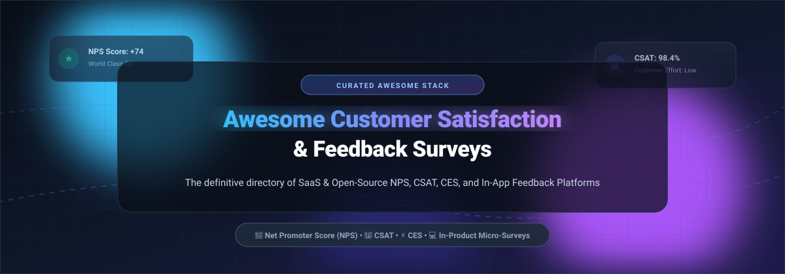

# Awesome-Customer-Satisfaction-Feedback-Surveys 🌟

  

  
  
  
  
  

---

## 🎯 Overview & Introduction 🚀

Welcome to the definitive, community-driven catalog of **Customer Satisfaction (CSAT)**, **Net Promoter Score (NPS)**, **Customer Effort Score (CES)**, and **In-Product Micro-Survey** platforms. 

Whether you are looking for enterprise-grade SaaS platforms with automated sentiment analytics, or self-hosted, privacy-first, GDPR-compliant open-source alternatives, this curated guide benchmarks the entire customer voice and feedback landscape.

### 🔍 Key Metrics Defined:
* 🌟 **Net Promoter Score (NPS):** Measures customer brand loyalty, retention likelihood, and advocacy via the standard 0–10 scale.
* 🎯 **Customer Satisfaction (CSAT):** Captures transactional sentiment immediately following specific customer interactions or feature releases.
* ⚡ **Customer Effort Score (CES):** Evaluates friction and ease-of-use during support resolutions and onboarding flows.
* 💬 **In-Product Micro-Surveys:** Contextual, event-triggered 1-to-2 question widgets displayed within web and mobile applications without code rewrites.

---

## 📑 Table of Contents 🧭

- [📊 Sector Overview & Market Dynamics](#-sector-overview--market-dynamics)
- [🏢 SaaS / Hosted Platforms](#-saas--hosted-platforms)
- [🔓 Open-Source GitHub Projects](#-open-source-github-projects)
- [📈 Star History](#-star-history)
- [🤝 How to Contribute](#-how-to-contribute)
- [💖 Support & Sponsorship](#-support--sponsorship)
- [⚠️ Disclaimer](#️-disclaimer)

---

## 📊 Sector Overview & Market Dynamics 📈

The global customer feedback and feedback management software market is estimated at approximately **$2.7B to $3.8B** (scaling toward **$18B+** when broadly encompassing enterprise experience management and survey platforms), expanding at an ~11–14% CAGR. The sector is **moderately fragmented**: while hundreds of specialized micro-survey apps, form builders, and point solutions compete for SME and product-led growth teams, large enterprise voice-of-the-customer (VoC) spending remains heavily consolidated among dominant incumbents (such as Qualtrics, Medallia, InMoment, and SurveyMonkey) that regularly acquire emerging point solutions.

---

## 🏢 SaaS / Hosted Platforms 🌐

The following table lists leading commercial SaaS customer satisfaction and survey solutions, sorted by company scale (valuation / market capitalization / revenue) in descending order:

| 🏢 Company / Product | 📏 Scale (Valuation / Revenue) | 🏷️ Starting Pricing Tier | 🎁 Free Tier / Trial Limits | 💡 Description & Core Focus |
| :--- | :--- | :--- | :--- | :--- |
| **[HubSpot Surveys](https://www.hubspot.com/)** | **~$21.0B–$35.9B** market cap (~$2.6B–$3.1B annual revenue) | **$100/seat/month** (Service Hub Professional tier required for NPS/CSAT surveys; or Service Hub Starter from $15/seat/month) | **14-day free trial** of Professional features (full access to surveys and ticketing; no credit card required); permanent Smart CRM free tier limited to 2 seats and 1,000 contacts (surveys excluded) | Native NPS, CSAT, and CES surveys tied directly to tickets, deals, and CRM automation records. |
| **[Qualtrics](https://www.qualtrics.com/)** | **$12.5B** valuation (acquired by Silver Lake; ~$1.5B annual revenue) | **$420/month** ($5,040/year billed annually for Strategic Research tier; enterprise CustomerXM is custom quote) | **Permanent free account** limited to **500 lifetime responses** across the account, 3 active surveys at a time, up to 30 questions/survey, and web link sharing (no email distribution) | Enterprise experience management platform with extensive survey logic, CES/NPS/CSAT metrics, and advanced text analytics. |
| **[SurveyMonkey](https://www.surveymonkey.com/)** | **$1.5B** valuation (acquired by STG; ~$481M annual revenue) | **$39/month** (Advantage tier billed annually at $468/year; or $99/month on month-to-month billing; Team plans from $30/user/month with 3-seat min) | **Permanent free Basic plan** with unlimited surveys, but capped at **10 questions per survey** and only **25–40 viewable responses per survey** (excess responses locked behind paywall; exports disabled) | High-volume general survey platform with standardized NPS templates, benchmark comparisons, and extensive ecosystem integrations. |
| **[Typeform](https://www.typeform.com/)** | **~$935M** valuation (~$80M–$140M+ ARR) | **$28/month** (Basic tier billed annually at $336/year; or $39/month billed monthly) | **Permanent free plan** limited to **10 responses/month**, unlimited forms, 1 user seat, and Typeform-branded survey interfaces | Conversational, one-question-at-a-time form and survey builder optimized for user engagement and mobile completion rates. |
| **[InMoment](https://inmoment.com/)** | **~$50M–$53M** annual revenue (Acquired by Press Ganey Forsta) | **~$50/user/month** for entry modules (Comprehensive Voice of Customer enterprise packages start around ~$25,000–$50,000/year custom quote) | **30-day free trial** available for digital micro-surveys / CoreCX modules (full XI enterprise suite evaluated via custom guided demo) | Enterprise Experience Improvement (XI) platform delivering omnichannel feedback aggregation, NLP sentiment detection, and case management. |
| **[AskNicely](https://www.asknicely.com/)** | **~$7.9M–$10.6M** annual revenue ($47M+ funding raised) | **$449/month** (Learn tier, billed annually; Grow tier starts at $849/month) | **No self-serve free trial** (access provided via personalized sales demonstration tailored to business CRM workflows) | Dedicated customer experience and NPS platform designed around real-time frontline employee coaching, feedback routing, and Google review generation. |
| **[CustomerGauge](https://customergauge.com/)** | **~$6.6M–$25M** annual revenue ($2.5M+ Series A funding) | **~$20,000/year** platform base license (approx. ~$1,666/month billed annually) | **No free tier or free trial** (offers structured 60–90 day paid pilots with dedicated onboarding rather than unpaid self-serve trials) | Account Experience (AX) platform designed specifically for B2B enterprises to tie Net Promoter Scores directly to account revenue, churn risk, and upsell pipelines. |
| **[Survicate](https://survicate.com/)** | **~$4.0M–$4.4M** ARR ($4.6M total funding) | **$49/month** (Starter tier billed annually, or $56/month billed monthly for 100 responses/month) | **Permanent free plan** limited to **25 responses/month**, 3 teammate seats, 1 active survey, and 300 lifetime responses; also offers a 10-day full-feature trial | Multi-channel feedback platform specializing in in-product micro-surveys, web popups, and email/link NPS questionnaires. |
| **[Delighted](https://delighted.com/)** | **~$1.1M–$4.5M** subsidiary revenue (Subsidiary of Qualtrics) | **$17/month** (Entry Starter tier for up to 50 responses/month; scales to $249+/month for Advanced tiers) | **Permanent free tier** capped at **25 responses/month**, 1 user seat, and 1 survey project (or 14-day premium feature trial) | Turnkey, minimal-friction NPS, CSAT, and CES survey automation across email, web, and SMS with instant team channel alerts. |
| **[Nicereply](https://www.nicereply.com/)** | **~$660K–$1.6M** annual revenue (Private / Bootstrapped) | **$59/month** (Starter tier for up to 100 responses/month, billed annually; or $79/month billed monthly) | **14-day free trial** with full feature access and unlimited test surveys (no credit card required; automatically expires without billing) | Support-desk feedback tool designed to trigger CSAT, CES, and NPS surveys directly within Zendesk, Freshdesk, Front, and Help Scout ticket interactions. |

---

## 🔓 Open-Source GitHub Projects 🛠️

A curated selection of the best open-source survey engines, customer feedback tools, and form builders, ranked in descending order by GitHub_Stars ⭐. Each repository includes a real-time badge linking directly to its stargazer community.

### 1. **[Formbricks](https://github.com/formbricks/formbricks)**  🌟
* **Description:** Open-source survey and experience management suite built as a privacy-centric alternative to Qualtrics and Delighted. Specializes in targeted, contextual in-product micro-surveys and event-based triggers.
* **Features:** In-app, web, link, and email surveys; no-code survey builder; behavioral user targeting without application redeployments; seamless integrations with Slack, Segment, n8n, and Zapier; full GDPR compliance and self-hosting.
* **Tech Stack:** TypeScript, Next.js, Tailwind CSS, Prisma, PostgreSQL.
* **License:** AGPL-3.0.

### 2. **[HeyForm](https://github.com/heyform/heyform)**  🌟
* **Description:** Open-source conversational form builder and modern Typeform alternative for engaging customer questionnaires, polls, and feedback widgets.
* **Features:** Visual drag-and-drop builder; complex conditional branch logic; 30+ question types; custom CSS styling and white-labeling; webhook dispatchers and CSV exports; single-command Docker deployment.
* **Tech Stack:** Node.js, React, MongoDB, Redis.
* **License:** AGPL-3.0.

### 3. **[SurveyJS Library](https://github.com/surveyjs/survey-library)**  🌟
* **Description:** Free and open-source JavaScript form and survey UI component library for modern web applications.
* **Features:** JSON-driven architecture; seamless framework support for React, Angular, Vue 2/3, and vanilla JS; multi-page survey wizards; dynamic branching and client-side calculations; full PDF export integration.
* **Tech Stack:** JavaScript, TypeScript (React, Angular, Vue).
* **License:** MIT.

### 4. **[Fider](https://github.com/getfider/fider)**  🌟
* **Description:** Open-source public customer feedback and product suggestion platform where users share ideas, vote on feature roadmaps, and discuss enhancements.
* **Features:** Upvoting boards; clean community discussions; email notifications; OAuth single sign-on (Google, GitHub, Facebook, Azure AD); markdown formatting; ultra-lightweight Docker deployment.
* **Tech Stack:** Go (Golang), React, PostgreSQL.
* **License:** AGPL-3.0.

### 5. **[SurveyKing](https://github.com/javahuang/SurveyKing)**  🌟
* **Description:** Feature-complete, enterprise-ready survey and examination system designed as a self-hosted alternative to SurveyMonkey.
* **Features:** One-command deployment; 20+ question types; permission-based multi-user workspace management; barcode and question flow logic; rich visual analytics dashboards; offline questionnaire collection support.
* **Tech Stack:** Java, Spring Boot, Vue.js, MySQL / PostgreSQL.
* **License:** Apache-2.0.

### 6. **[Xiaoju Survey](https://github.com/didi/xiaoju-survey)**  🌟
* **Description:** Enterprise-grade questionnaire, survey, and quiz system open-sourced by Didi.
* **Features:** Rich question configuration; flexible visual theme builder; logic jump rules; automated statistical charting; cross-device responsive survey rendering; enterprise access control.
* **Tech Stack:** Node.js (NestJS), Vue 3, TypeScript, MySQL.
* **License:** Apache-2.0.

### 7. **[LimeSurvey](https://github.com/LimeSurvey/LimeSurvey)**  🌟
* **Description:** The veteran, research-grade open-source survey engine trusted since 2006 by leading universities, market researchers, and governments globally.
* **Features:** 30+ sophisticated question types; 80+ supported languages; advanced statistical data export (SPSS, R, STATA, CSV); intricate quota management; assessment scoring; full WCAG 2.0 and GDPR compliance.
* **Tech Stack:** PHP, MySQL / MariaDB / PostgreSQL.
* **License:** GPL-2.0.

### 8. **[DWSurvey](https://github.com/wkeyuan/DWSurvey)**  🌟
* **Description:** Convenient, secure, and extensible open-source online survey questionnaire and assessment tool.
* **Features:** WYSIWYG questionnaire designer; branch logic rules; mobile-optimized response views; data cross-analysis; multiple export formats; role-based administration.
* **Tech Stack:** Java, Spring Boot, React, MySQL.
* **License:** AGPL-3.0.

### 9. **[OhMyForm](https://github.com/ohmyform/ohmyform)**  🌟
* **Description:** Clean, lightweight open-source form builder and survey tool inspired by Typeform and TellForm.
* **Features:** Embeddable responsive forms; Forms-as-a-Service API; customizable webhook notifications on submission; submissions exportable to XLS, JSON, and CSV; minimal deployment footprint.
* **Tech Stack:** Node.js, Vue.js, PostgreSQL / SQLite.
* **License:** Apache-2.0.

### 10. **[Astuto](https://github.com/astuto/astuto)**  🌟
* **Description:** Modern, self-hosted customer feedback tool and public feature request board inspired by Canny.
* **Features:** User feedback collection; roadmap boards; changelog publishing; user upvoting; privacy-centric self-hosting via Docker; clean UI design.
* **Tech Stack:** Ruby on Rails, Vue.js, PostgreSQL.
* **License:** GNU GPLv3.
 
### 11. **[LogChimp](https://github.com/logchimp/logchimp)**  🌟
* **Description:** Open-source product feedback tracker and feature request management software alternative to Canny and ProductBoard.
* **Features:** Public and private feedback boards; user voting and roadmap prioritization; user sentiment tracking; customizable statuses; fast modern web application.
* **Tech Stack:** Node.js, Express, Vue.js, PostgreSQL.
* **License:** Apache-2.0.

---

## ⭐ Star History 📊

---

## 🤝 How to Contribute ✍️

We warmly welcome community contributions to keep this feedback stack current, accurate, and comprehensive!

1. 🍴 **Fork** this repository.
2. 🌿 Create a new feature branch (`git checkout -b feature/add-new-tool`).
3. 📝 Add or update entries following the established table / list format (provide factual descriptions, license, scale, and pricing details).
4. 🚀 Commit your changes (`git commit -m 'Add ToolName to open-source section'`).
5. 📤 Push to your fork (`git push origin feature/add-new-tool`).
6. 📬 Submit a **Pull Request** detailing why the tool is a great addition to the ecosystem.

---

## 💖 Support & Sponsorship ☕

Thank you for visiting and using **Awesome Customer Satisfaction & Feedback Surveys**! 🎉

If you found this curated list helpful for your organization, product stack, or research:
* ⭐ **Star** this repository on GitHub to help others discover it.
* 🍴 **Fork** and share it across your developer and CX communities.
* ☕ **Buy a coffee / Sponsor the project**: Support continuous research and repository maintenance via the [GitHub Sponsor Dashboard](https://github.com/sponsors/ishandutta2007).

---

## ⚠️ Disclaimer 📜

- This repository is an independent, **community-curated** directory and does not constitute a formal endorsement of any listed service or product.
- **Data Protection & Privacy:** Customer feedback software frequently captures customer personally identifiable information (PII), contact data, and sentiment. Always ensure your deployment and vendor agreements comply with relevant legislation (GDPR, CCPA, HIPAA, etc.).
- **Pricing & Features:** SaaS subscription prices, free plan limits, and product architectures evolve constantly. Validate current pricing and quotas directly with official vendor documentation prior to purchasing decisions.

---

  <b>Built with ❤️ for product engineers, CX leaders, and teams building world-class customer feedback experiences.</b>

